# fake-bolt

A ride-hailing backend inspired by Bolt, built as microservices with NestJS, TypeScript, PostgreSQL, Redis, Kafka and Socket.io, plus a fake AWS (Floci) for S3 and a full Prometheus / Grafana / Loki observability stack.

> **Status: work in progress, but the core flow works end to end.** The full stack boots in Docker and the k6 load test **passes all 15 thresholds**: 284 drivers signed up, proved the photo rules, went online, got matched, drove a ride and went back to the pool, and every rider got a receipt email. See [Load test results](#load-test-results).

## Architecture

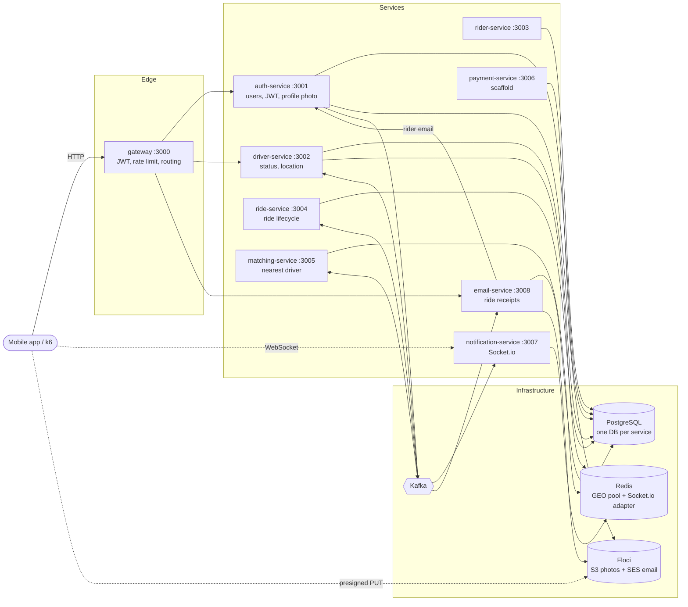

- **Kafka over RabbitMQ:** the services exchange a stream of facts (ride requested, driver assigned...) that several consumers read independently.
- **Socket.io bypasses the gateway:** WebSocket connections are stateful, the gateway stays stateless HTTP.
- **Redis GEO for matching:** available drivers live in a GEO set, so finding the nearest one is a `GEOSEARCH`, not a table scan.
- **Identity from the JWT only:** the gateway verifies the token and forwards `x-user-id`; services never trust a user id from the request body (done for `/users/me`, still to do for drivers and rides).

## Services

| Service | Port | Storage | What it does |
|---|---|---|---|
| gateway | 3000 (published) | none | Verifies JWTs, routes `/auth`, `/users/me`, `/drivers`, passes downstream status codes through (4xx are not turned into 500) |
| auth-service | 3001 | `auth_db`, S3 | Register / login (bcrypt + JWT), profile photo upload, publishes `user.photo.updated` |
| driver-service | 3002 | `driver_db`, Redis GEO | Driver profile, online status, location; keeps the `drivers:available` pool; consumes ride events to set BUSY / AVAILABLE |
| rider-service | 3003 | `rider_db` | Rider profile (create / get) |
| ride-service | 3004 | `ride_db` | Ride request, status updates, history; publishes `ride.requested`, `ride.status.updated`, `ride.completed` |
| matching-service | 3005 | Redis GEO | Consumes `ride.requested`, atomically claims the nearest driver, publishes `driver.assigned` |
| notification-service | 3007 (published) | Redis (adapter) | Socket.io push to riders and drivers for ride and payment events |
| payment-service | 3006 | `payment_db` | Nest scaffold only, Stripe flow still to build |
| email-service | 3008 | `email_db`, SES | Consumes `ride.completed`, emails the rider a receipt through SES (Floci), keeps every email in `sent_emails`, which is also the rider's ride history |
| seed | none | none | Creates 100 drivers and 200 riders around Tallinn through the real APIs |

Every service exposes `GET /health` (returns `OK`) for the compose healthchecks and `GET /metrics` for Prometheus. All of them listen on the `PORT` compose gives them.

### Databases

- One Postgres instance, one database per service. `auth_db` comes from `POSTGRES_DB`; the rest (`driver_db`, `rider_db`, `ride_db`, `payment_db`, `email_db`) are created by `postgres/init/01-create-databases.sql` on the first boot.
- Each service's `orm.ts` (at the service root) connects with `DATABASE_URL` and runs its migrations when the service starts (`migrationsRun: true`). Migrations use the QueryRunner API with snake_case columns; entities map their camelCase properties to them with `@Column({ name })`.

## Ride flow

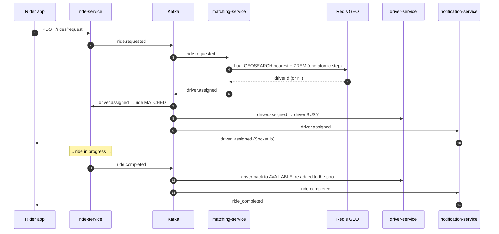

### Kafka topics

| Topic | Producer | Consumers |
|---|---|---|
| `ride.requested` | ride | matching |
| `driver.assigned` | matching | ride, driver, notification |
| `ride.status.updated` | ride | notification, driver (cancellations) |
| `ride.completed` | ride | notification, driver, email |
| `user.photo.updated` | auth | driver |
| `driver.status.updated` | driver | none yet |
| `driver.location.updated` | driver | none yet |
| `driver.declined` | none yet | matching |
| `payment.completed` / `payment.failed` | none yet | notification |

Messages are keyed (by `driverId`, `rideId` or `userId`) so events for the same entity stay ordered on one partition. The driver, matching and notification consumers start in `onApplicationBootstrap`, after every handler is registered, so early events aren't lost.

## Driver status

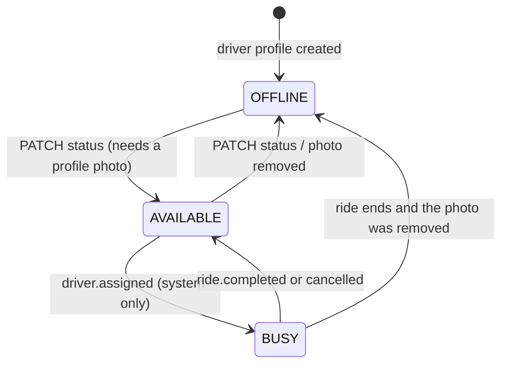

- Only **AVAILABLE** drivers are in the Redis pool, so only they can be matched.
- **BUSY is owned by the system:** `PATCH status=busy` returns **422**, and any manual change while BUSY returns **409** ("finish the current ride first"). Location pings from a busy driver never put them back in the pool.
- **Matching is race-free:** a Lua script runs `GEOSEARCH` and `ZREM` atomically, so two rides (or two matching instances) can't claim the same driver.

## Profile photos (Floci S3)

The photo belongs to the person, so auth-service owns it (`users.photo_key`). It is **mandatory for drivers** (they can't go online without one) and **optional for riders**.

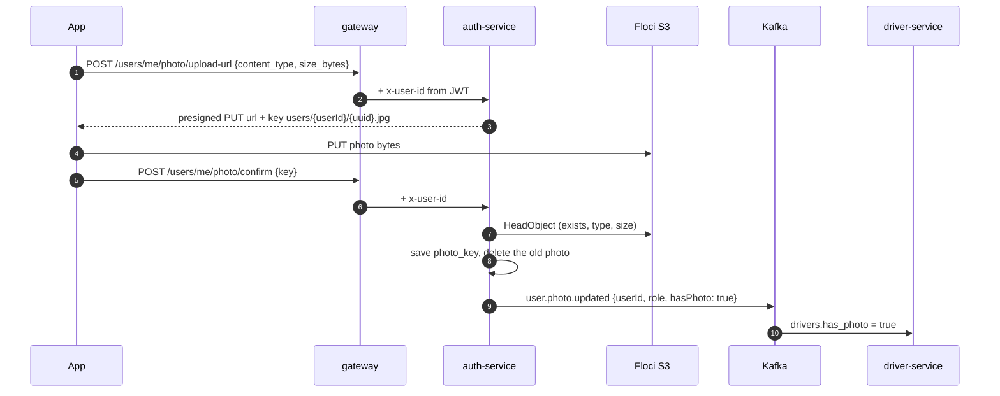

- Allowed: jpeg, png, webp, up to 5 MB. The server picks the key, so a user can only write under their own folder.
- Removing the photo (`DELETE /users/me/photo`) while a driver is online takes them offline and out of the pool.
- Planned next: a validation Lambda (like fake-vinted) that checks the real file and makes a thumbnail.

## Ride receipts by email (SES on Floci)

When a ride completes, the rider gets a receipt email. It's sent through **AWS SES emulated by Floci**, with the same `@aws-sdk/client-sesv2` code you'd use on real AWS and nothing extra to run.

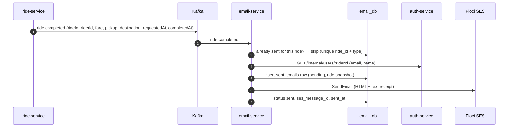

- **Why a separate service:** email has different rules from socket pushes. A push that arrives 5 min late is useless, so notification-service skips failures. A receipt must be retried and never sent twice, which needs a database. Keeping them apart also means a slow email provider can't delay ride notifications.
- **Never twice:** the unique `(ride_id, type)` index skips events Kafka delivers again (`emails_duplicate_skipped_total`).
- **Retries:** if SES or auth-service fails, the consumer rethrows and Kafka retries; the row keeps `attempts` and `last_error`. A rider who doesn't exist is final: recorded as failed, not retried.
- **Ride history:** each row stores a snapshot of the ride (fare, pickup, destination, times), so `GET /users/me/receipts` shows past rides even when ride-service is down.
- **Sender identity:** SES only sends from verified addresses, on Floci as on AWS. `floci/init/ready.d/02-verify-ses-sender.sh` verifies `no-reply@fakebolt.local` on boot.
- **See the emails:** `curl http://localhost:4566/_aws/ses` lists every message Floci captured.

## API (through the gateway, `http://localhost:3000`)

| Method | Path | Auth | Notes |
|---|---|---|---|
| POST | `/auth/register` | public | `{email, password, name, role: rider\|driver}` → `{token}` |
| POST | `/auth/login` | public | `{email, password}` → `{token}` |
| GET | `/users/me` | JWT | Profile with `photo_url` and `photo_required` |
| POST | `/users/me/photo/upload-url` | JWT | `{content_type, size_bytes}` → presigned URL |
| POST | `/users/me/photo/confirm` | JWT | `{key}` |
| DELETE | `/users/me/photo` | JWT | |
| GET | `/users/me/receipts` | JWT | Past rides with their emailed receipts, newest first |
| GET | `/drivers/:id` | JWT | |
| PATCH | `/drivers/:id/status` | JWT | `{status: available\|offline}` (422 without photo, 409 while busy) |
| PATCH | `/drivers/:id/location` | JWT | `{lat, lng}` |
| GET | `/health`, `/metrics` | public | |

Real-time events: connect Socket.io to `http://localhost:3007?userId=<id>` and listen for `driver_assigned`, `ride_request`, `ride_status_updated`, `ride_completed`, `payment_completed`, `payment_failed`.

Ride and rider endpoints exist on their services (`POST /rides/request`, `GET /rides/:id`, `PATCH /rides/:id/status`, `POST /riders`...) but aren't routed through the gateway yet.

## Observability

- **Metrics:** every service exposes `/metrics` (prom-client). Grafana Alloy scrapes them plus the Kafka, Redis and Postgres exporters and remote-writes to Prometheus.
- **Email metrics:** `emails_sent_total`, `emails_failed_total{reason}`, `emails_duplicate_skipped_total`, `email_send_duration_seconds`, `email_delivery_delay_seconds` (ride completed → receipt sent). Alerts: `RideReceiptsFailing`, `RideReceiptsSlow`.
- **Business metrics:** `ride_matching_duration_seconds`, `matching_attempts/success/failed_total`, `driver_location_updates_total`, `driver_status_updates_total`, `ride_requests_total`, `socket_connections_active`, `notifications_sent_total`, `notifications_skipped_total`, `kafka_messages_produced/consumed/failed_total`.
- **Dashboard:** *fake-bolt overview* (8 panels, see [Grafana dashboard](#grafana-dashboard)), provisioned from `grafana/`.
- **Logs:** Winston writes JSON to `/logs/<service>.log`; Alloy ships them to Loki.
- **Alerts:** `prometheus/alerts.yml` covers availability, p99 latency, error rate, matching too slow, stale driver locations, Redis memory and Postgres connections (no Alertmanager yet).

| Tool | URL |
|---|---|
| Prometheus | http://localhost:9090 |
| Grafana | http://localhost:3300 (dashboard *fake-bolt overview*) |
| Loki | http://localhost:3100 |
| Floci (S3, SES) | http://localhost:4566 (sent emails: `/_aws/ses`) |

## Docker images

All services use **pnpm 10.34.8** (pinned with `packageManager`, installed in the image through corepack) and the same 3-stage `node:22-alpine` Dockerfile:

1. **base:** corepack + pnpm
2. **builder:** `pnpm install --frozen-lockfile`, `pnpm run build`
3. **production:** `pnpm install --prod --frozen-lockfile`, only `dist/`, `NODE_ENV=production`, runs as `node`, `CMD node dist/src/main.js`

`orm.ts` and `logger.ts` live at each service root, which is why the build lands in `dist/src`. A per-service `.dockerignore` keeps `node_modules`, `.env` and tests out of the build context, and the pnpm store is a BuildKit cache mount, so it never ends up in the image. Production dependencies range from 43 MB (matching) to 160 MB (auth).

## Load test (k6)

A custom k6 image (`k6/Dockerfile`) built with [xk6-socket.io](https://github.com/xemax32/xk6-socket.io) v0.1.0, the same extension as fake-vinted. k6's own WebSocket client speaks raw WebSocket, not the Socket.io protocol, so it can't receive notification-service events. It starts after the services it depends on, its entrypoint waits until the gateway answers `/health`, then it runs the test and exits.

**Scenario `driver_ride_flow`** (ramps 2 → 5 VUs), one full driver shift per iteration:

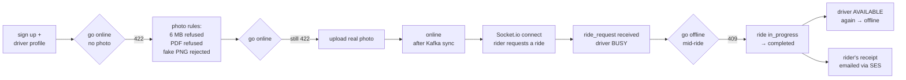

The "fake photo" is a text file uploaded as `image/png`: S3 accepts it, and auth-service's confirm rejects it by checking the file's first bytes (PNG / JPEG / WEBP signatures).

**Scenario `rider_app`** (2 VUs): register, login, wrong password (401), and checks the photo is optional for riders.

**Custom metrics** (all tagged with `test_type` per scenario; URLs with ids are tagged with a fixed `name` like `PATCH /drivers/:id/status`):

| Kind | Metrics |
|---|---|
| Counters | `drivers_registered`, `driver_online_refused_no_photo`, `photo_upload_refused`, `fake_photos_rejected`, `photos_confirmed`, `drivers_online`, `rides_requested`, `rides_assigned`, `ride_assignment_timeouts`, `busy_status_change_refused`, `rides_completed`, `drivers_released`, `riders_registered`, `socket_errors` |
| Timings | `photo_sync_time` (confirm → allowed online), `ride_assignment_time` (request → driver notified), `driver_busy_sync_time`, `driver_release_time`, plus per-endpoint durations |
| Rates | `no_photo_refused_rate`, `fake_photo_rejected_rate` (both must be > 99%), `driver_online_rate`, `ride_assigned_rate` |

**Summary:** at the end k6 prints its text summary plus a short business result (PASSED / FAILED, drivers online, fake photos rejected, rides assigned, p95 assignment time, failed thresholds). Files written to `k6_reports/`:

- `fake-bolt.k6.html`: HTML report
- `fake-bolt.k6.result.txt`: the business result
- `fake-bolt.k6.summary.json`: raw summary

Metrics are also pushed to Prometheus (`experimental-prometheus-rw`), so the run shows up in Grafana next to the service metrics.

Ride and driver-profile endpoints aren't behind the gateway yet, so the test calls driver-service and ride-service directly on the compose network.

## Load test results

Latest run, 6 Nov 2026 (the second full run; the first gave the same picture): about 4 minutes, up to 7 VUs (5 driver flows + 2 rider apps). **Result: PASSED, 15/15 thresholds.** Live graphs of this run are in [Grafana dashboard](#grafana-dashboard).

📊 Full HTML report: [`k6_reports/fake-bolt.k6.html`](k6_reports/fake-bolt.k6.html). GitHub shows HTML as source, so download it or open it locally. Also: [`fake-bolt.k6.result.txt`](k6_reports/fake-bolt.k6.result.txt) (business summary) and [`fake-bolt.k6.summary.json`](k6_reports/fake-bolt.k6.summary.json) (raw).

| Business rule / flow | Result |
|---|---|
| Driver can't go online without a photo (422) | 284 / 284 refused (100%) |
| Photo over 5 MB or not an image type refused | 568 / 568 |
| Fake photo (text sent as `image/png`) rejected on confirm | 284 / 284 (100%) |
| Real photo accepted, driver online after the Kafka sync | 284 / 284 (100%) |
| Ride requested → driver gets `ride_request` over Socket.io | 284 / 284 (100%), 0 timeouts |
| Driver can't change status mid-ride (409) | 284 / 284 |
| Ride completed → driver back in the pool | 284 / 284 |
| Rider gets the receipt email (SES on Floci) | 284 / 284 (100%) |

| Timing | avg | p95 | p99 |
|---|---|---|---|
| Ride assignment (request → driver notified) | 9 ms | **17 ms** | 59 ms |
| Photo sync (confirm → allowed online, via Kafka) | 52 ms | 513 ms | 543 ms |
| Driver BUSY after assignment | 115 ms | 260 ms | 263 ms |
| Driver back to AVAILABLE after the ride | 117 ms | 260 ms | 264 ms |
| Receipt emailed after completion | 287 ms | 519 ms | 522 ms |
| All HTTP requests (8,830, 0 failed) | 17 ms | 70 ms | 87 ms |
| Socket.io connect (284 sessions) | 0.6 ms | 0.9 ms | 2.2 ms |

Checks: **10,502 passed, 0 failed**. Things the run caught and that are now fixed: the gateway answering 401 on its public routes, Kafka refusing to start after a restart (ZooKeeper volumes), a missing build dependency in ride-service, the xk6 Go version, and the shape of Socket.io event payloads in k6.

## Grafana dashboard

The **fake-bolt overview** dashboard is provisioned from the repo (`grafana/provisioning/` + `grafana/dashboards/fake-bolt-overview.json`), together with the Prometheus and Loki data sources, so it's there on every start at http://localhost:3300 (folder *fake-bolt*). Screenshots below are from the k6 run above.

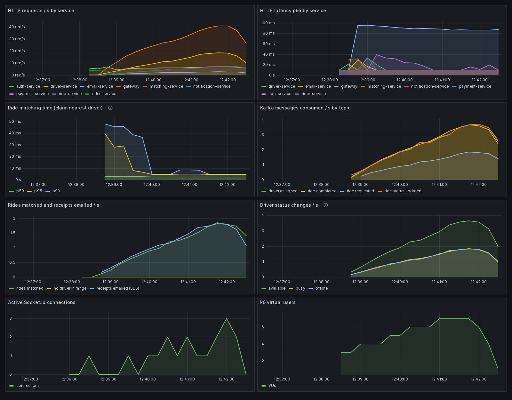

| | |
|---|---|
| 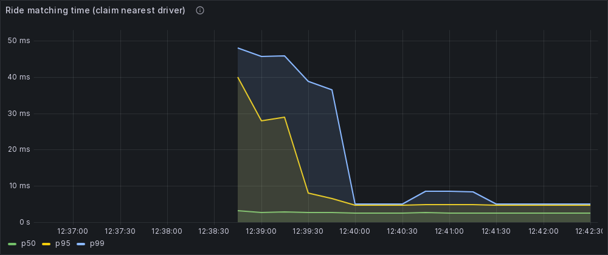 **Ride matching time.** p50 stays around 3 ms; p95 starts near 40 ms while connections warm up and settles at about 5 ms. This is the atomic Lua claim (`GEOSEARCH` + `ZREM`). | 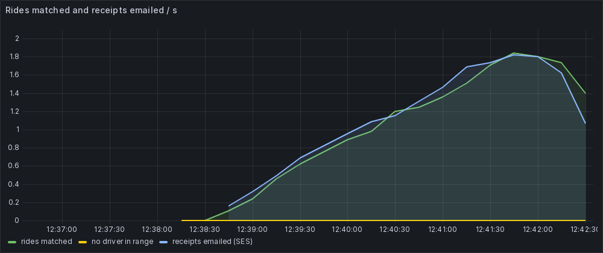 **Rides matched and receipts emailed.** The two lines track each other: every matched ride ends with a receipt through SES. "No driver in range" stays at 0. |
| 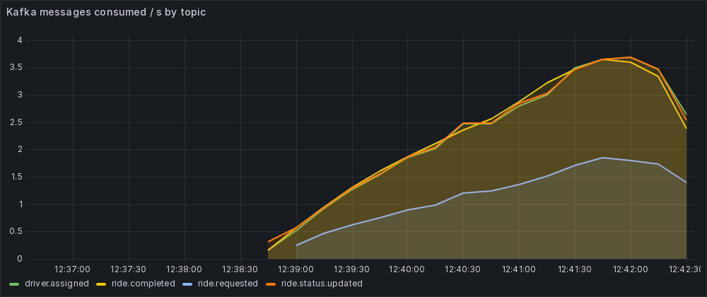 **Kafka messages consumed by topic.** `driver.assigned` and `ride.completed` are each read by two instrumented consumers, and `ride.status.updated` is published twice per ride (matched, in progress), so all three run at two messages per ride; `ride.requested` runs at half, only matching reads it. | 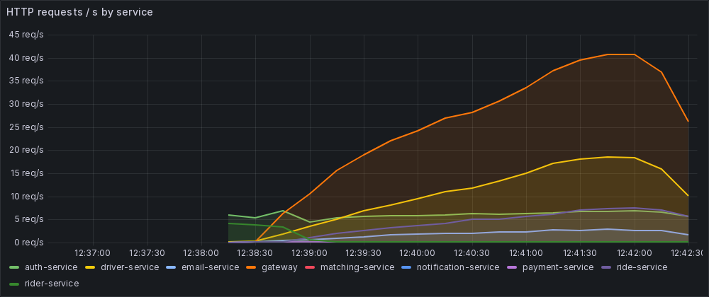 **HTTP requests by service.** The gateway carries most traffic as the load ramps up to 7 VUs; driver-service is next (status, location, profile). |
| 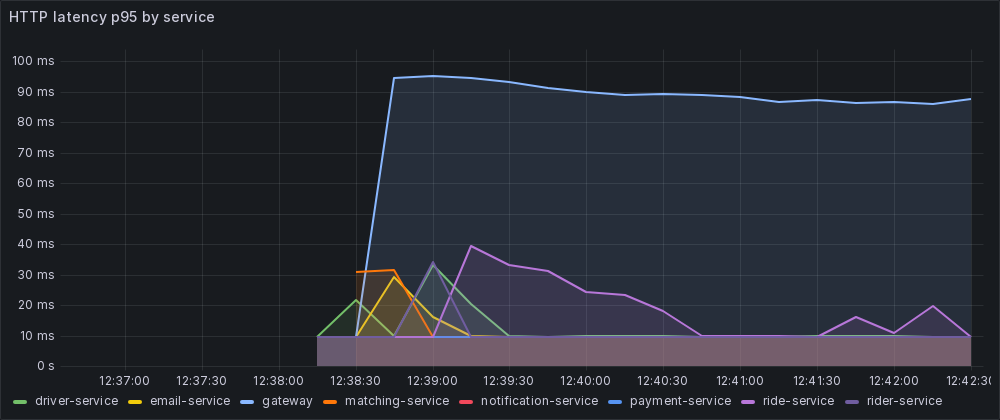 **HTTP latency p95 by service.** The gateway is highest (~90 ms) because it includes the downstream call, and registration hashes passwords with bcrypt. The services themselves stay around 10–40 ms. | 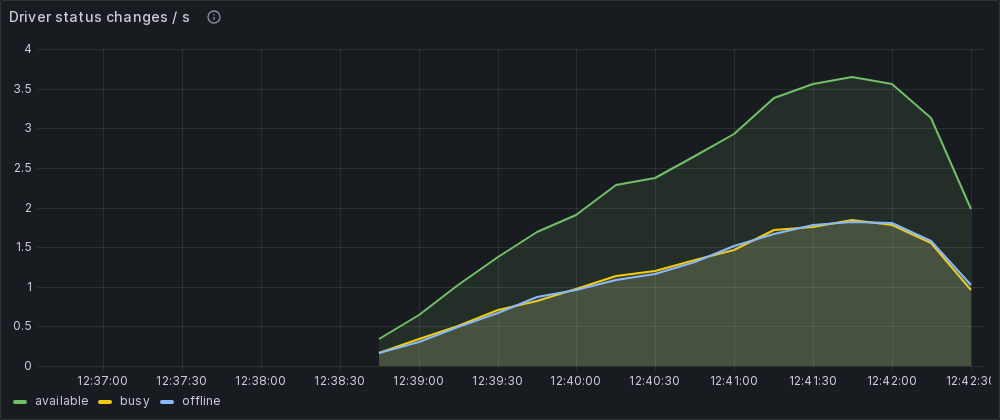 **Driver status changes.** Every driver goes available → busy → available → offline, so `available` runs at twice the rate of `busy` and `offline`. |
| 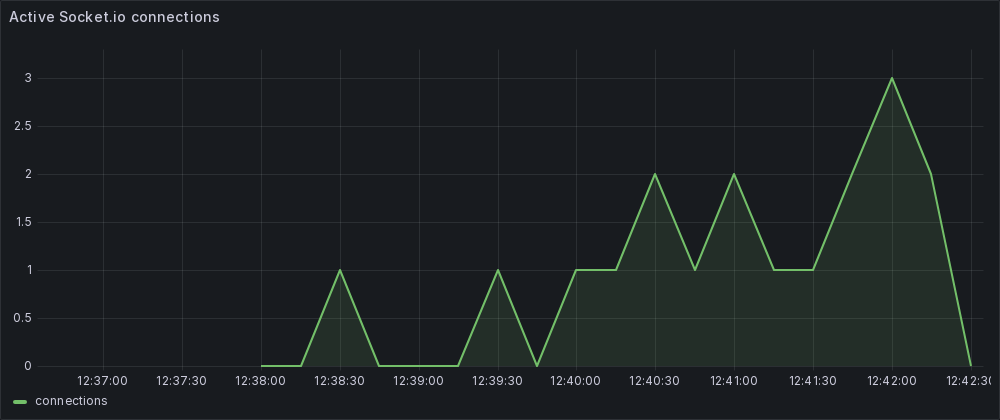 **Active Socket.io connections.** One per driver waiting for a ride, closed once the ride completes. | 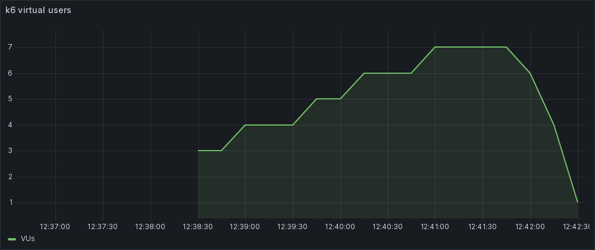 **k6 virtual users.** The load profile: ramps to 7 VUs, holds, ramps down. |

To open it yourself: `docker compose up -d`, run k6, then visit http://localhost:3300 (admin / `GRAFANA_PASSWORD`). The screenshots were taken with Playwright + headless Chromium; for that run Grafana was started with `GRAFANA_ANONYMOUS=true` (read-only anonymous access, off by default).

## Running it

```bash
cp env.example .env              # then set a real JWT_SECRET: openssl rand -hex 32
docker compose up -d --build     # infra, services, observability, Floci, seed
docker compose ps                # wait until the services show (healthy)
docker compose --profile testing run --rm k6   # load test, container removed when it ends
docker compose down -v --rmi all # clean up containers, images and volumes
```

- `depends_on` only waits for containers to **start**, not to be ready. The Node services have `restart: on-failure`, so one that boots before Kafka or Postgres is ready exits and comes back; the seed and k6 wait for `/health` themselves.
- The database init script only runs on an **empty** Postgres volume. If you ran an older version of the stack, do `docker compose down -v` once first.
- Sent emails: `curl http://localhost:4566/_aws/ses`. k6 reports: `k6_reports/`.

Local development of a single service:

```bash
cd driver-service
npx pnpm@10.34.8 install
npx pnpm@10.34.8 run start:dev
```

## What's been done so far

- Microservice skeleton for gateway, auth, driver, rider, ride, matching, notification and payment, with Postgres migrations (QueryRunner API), Kafka, Redis and a seed.
- `GET /health` in all 8 services.
- Kafka message keys fixed (the key must sit inside `messages[]`).
- Profile photos on Floci S3: presigned upload, confirm, delete, mandatory for drivers, synced to driver-service over Kafka.
- Gateway: `/users/me` routes, identity from the JWT, real downstream status codes.
- Switched every service to pnpm; rebuilt the Dockerfiles (Node 22, non-root, `.dockerignore`, `dist/src/main.js`); bcrypt 6 with prebuilt Alpine binaries.
- notification-service: real `/metrics`, Redis adapter done the Nest way, module wiring fixed, events without a recipient counted instead of emitted to `undefined`.
- matching-service: Redis GEO matching implemented with an atomic Lua claim, full matching metrics, consumer that retries instead of dropping ride requests.
- driver-service: BUSY lifecycle driven by ride events, so a driver on a ride never gets another request.
- auth-service checks the photo's real bytes on confirm, so a renamed text file can't pass as a driver photo.
- Boot fixes: `orm.ts` on `DATABASE_URL` with migrations on start, Postgres init script, snake_case column mapping, `PORT` everywhere, Nest wiring fixed in auth/ride/rider (every service passes a dependency preview check), `/metrics` on every service, seed fixed, `restart: on-failure`.
- k6 load test with a custom Socket.io-capable image, driver photo rules, the full ride flow, custom metrics and a business summary.
- email-service: ride receipts through SES on Floci, `sent_emails` log with a ride snapshot (QueryRunner migration), no duplicate sends, retries, Prometheus metrics + alerts, scraped by Alloy; `GET /users/me/receipts` on the gateway; k6 checks every completed ride gets its receipt.

## Next up

1. Alertmanager, and a Loki logs panel on the dashboard.
2. Route rides and riders through the gateway, with identity from the JWT and role checks.
3. Accept / decline with a timeout, then **forward dispatch**: offer the next ride to a busy driver whose current ride ends near the pickup.
4. No-driver path (retry with a wider radius, then `ride.matching.failed`), ride state machine, server-side fares.
5. Payment service with Stripe test mode.
6. Unit and e2e tests, CI.

