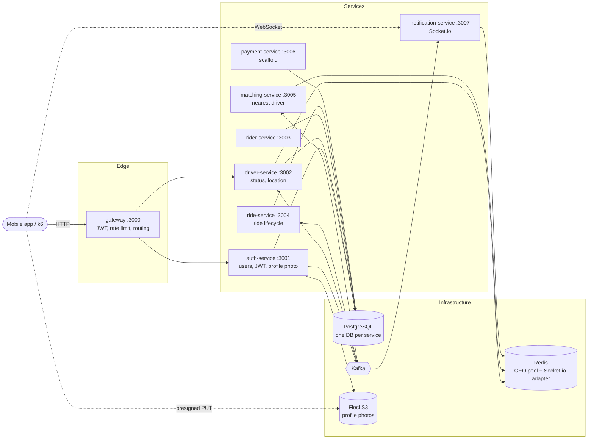
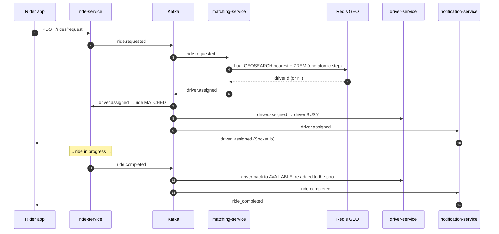
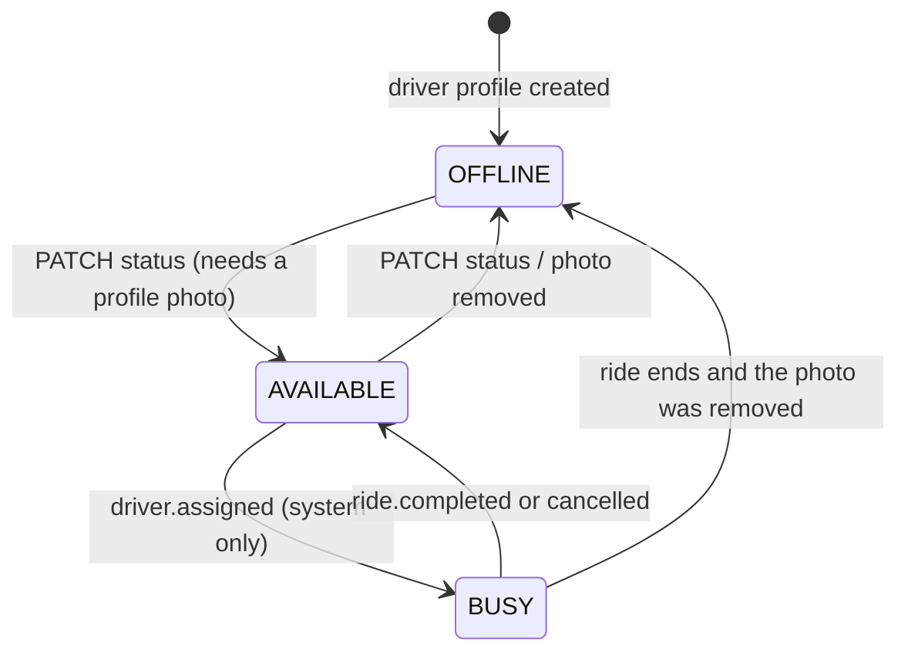
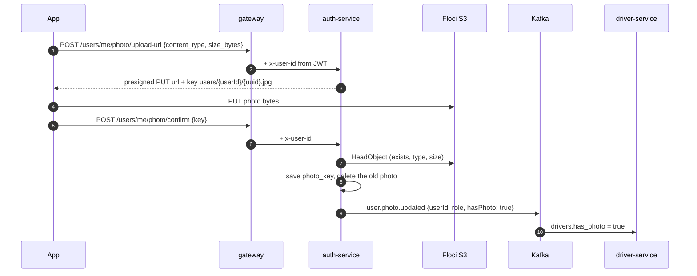

# fake-bolt

A ride-hailing backend inspired by Bolt, built as microservices with NestJS, TypeScript, PostgreSQL, Redis, Kafka and Socket.io, plus a fake AWS (Floci) for S3 and a full Prometheus / Grafana / Loki observability stack.

> **Status: work in progress.** Every service compiles and the core ride flow is wired end to end in code, but the stack has not been booted in Docker yet. A few P0 items (wrong ports in 4 services, the DB connection settings) still block a clean `docker compose up`. The full, filterable gap list lives in [`project-analysis.html`](project-analysis.html).

## Architecture



- **Kafka over RabbitMQ:** the services exchange a stream of facts (ride requested, driver assigned...) that several consumers read independently.
- **Socket.io bypasses the gateway:** WebSocket connections are stateful, the gateway stays stateless HTTP.
- **Redis GEO for matching:** available drivers live in a GEO set, so finding the nearest one is a `GEOSEARCH`, not a table scan.
- **Identity from the JWT only:** the gateway verifies the token and forwards `x-user-id`; services never trust a user id from the request body (done for `/users/me`, still to do for drivers and rides).

## Services

| Service | Port | Storage | What it does |
|---|---|---|---|
| gateway | 3000 (published) | none | Verifies JWTs, routes `/auth`, `/users/me`, `/drivers`, passes downstream status codes through (4xx are not turned into 500) |
| auth-service | 3001 | `auth_db`, S3 | Register / login (bcrypt + JWT), profile photo upload, publishes `user.photo.updated` |
| driver-service | 3002 | `driver_db`, Redis GEO | Driver profile, online status, location; keeps the `drivers:available` pool; consumes ride events to set BUSY / AVAILABLE |
| rider-service | 3003 | `rider_db` | Rider profile (create / get) |
| ride-service | 3004 | `ride_db` | Ride request, status updates, history; publishes `ride.requested`, `ride.status.updated`, `ride.completed` |
| matching-service | 3005 | Redis GEO | Consumes `ride.requested`, atomically claims the nearest driver, publishes `driver.assigned` |
| notification-service | 3007 (published) | Redis (adapter) | Socket.io push to riders and drivers for ride and payment events |
| payment-service | 3006 | `payment_db` | Nest scaffold only, Stripe flow still to build |
| seed | none | none | Creates 100 drivers and 200 riders around Tallinn through the real APIs |

Every service exposes `GET /health` (returns `OK`) for the compose healthchecks.

## Ride flow



### Kafka topics

| Topic | Producer | Consumers |
|---|---|---|
| `ride.requested` | ride | matching |
| `driver.assigned` | matching | ride, driver, notification |
| `ride.status.updated` | ride | notification, driver (cancellations) |
| `ride.completed` | ride | notification, driver |
| `user.photo.updated` | auth | driver |
| `driver.status.updated` | driver | none yet |
| `driver.location.updated` | driver | none yet |
| `driver.declined` | none yet | matching |
| `payment.completed` / `payment.failed` | none yet | notification |

Messages are keyed (by `driverId`, `rideId` or `userId`) so events for the same entity stay ordered on one partition. The driver, matching and notification consumers start in `onApplicationBootstrap`, after every handler is registered, so early events aren't lost.

## Driver status



- Only **AVAILABLE** drivers are in the Redis pool, so only they can be matched.
- **BUSY is owned by the system:** `PATCH status=busy` returns **422**, and any manual change while BUSY returns **409** ("finish the current ride first"). Location pings from a busy driver never put them back in the pool.
- **Matching is race-free:** a Lua script runs `GEOSEARCH` and `ZREM` atomically, so two rides (or two matching instances) can't claim the same driver.

## Profile photos (Floci S3)

The photo belongs to the person, so auth-service owns it (`users.photo_key`). It is **mandatory for drivers** (they can't go online without one) and **optional for riders**.



- Allowed: jpeg, png, webp, up to 5 MB. The server picks the key, so a user can only write under their own folder.
- Removing the photo (`DELETE /users/me/photo`) while a driver is online takes them offline and out of the pool.
- Planned next: a validation Lambda (like fake-vinted) that checks the real file and makes a thumbnail.

## API (through the gateway, `http://localhost:3000`)

| Method | Path | Auth | Notes |
|---|---|---|---|
| POST | `/auth/register` | public | `{email, password, name, role: rider\|driver}` → `{token}` |
| POST | `/auth/login` | public | `{email, password}` → `{token}` |
| GET | `/users/me` | JWT | Profile with `photo_url` and `photo_required` |
| POST | `/users/me/photo/upload-url` | JWT | `{content_type, size_bytes}` → presigned URL |
| POST | `/users/me/photo/confirm` | JWT | `{key}` |
| DELETE | `/users/me/photo` | JWT | |
| GET | `/drivers/:id` | JWT | |
| PATCH | `/drivers/:id/status` | JWT | `{status: available\|offline}` (422 without photo, 409 while busy) |
| PATCH | `/drivers/:id/location` | JWT | `{lat, lng}` |
| GET | `/health`, `/metrics` | public | |

Real-time events: connect Socket.io to `http://localhost:3007?userId=<id>` and listen for `driver_assigned`, `ride_request`, `ride_status_updated`, `ride_completed`, `payment_completed`, `payment_failed`.

Ride and rider endpoints exist on their services (`POST /rides/request`, `GET /rides/:id`, `PATCH /rides/:id/status`, `POST /riders`...) but aren't routed through the gateway yet.

## Observability

- **Metrics:** every service exposes `/metrics` (prom-client). Grafana Alloy scrapes them plus the Kafka, Redis and Postgres exporters and remote-writes to Prometheus.
- **Business metrics:** `ride_matching_duration_seconds`, `matching_attempts/success/failed_total`, `driver_location_updates_total`, `driver_status_updates_total`, `ride_requests_total`, `socket_connections_active`, `notifications_sent_total`, `notifications_skipped_total`, `kafka_messages_produced/consumed/failed_total`.
- **Logs:** Winston writes JSON to `/logs/<service>.log`; Alloy ships them to Loki.
- **Alerts:** `prometheus/alerts.yml` covers availability, p99 latency, error rate, matching too slow, stale driver locations, Redis memory and Postgres connections (no Alertmanager yet).

| Tool | URL |
|---|---|
| Prometheus | http://localhost:9090 |
| Grafana | http://localhost:3300 |
| Loki | http://localhost:3100 |
| Floci (S3) | http://localhost:4566 |

## Docker images

All services use **pnpm 10.34.8** (pinned with `packageManager`, installed in the image through corepack) and the same 3-stage `node:22-alpine` Dockerfile:

1. **base:** corepack + pnpm
2. **builder:** `pnpm install --frozen-lockfile`, `pnpm run build`
3. **production:** `pnpm install --prod --frozen-lockfile`, only `dist/`, `NODE_ENV=production`, runs as `node`, `CMD node dist/src/main.js`

`orm.ts` and `logger.ts` live at each service root, which is why the build lands in `dist/src`. A per-service `.dockerignore` keeps `node_modules`, `.env` and tests out of the build context, and the pnpm store is a BuildKit cache mount, so it never ends up in the image. Production dependencies range from 43 MB (matching) to 160 MB (auth).

## Running it

```bash
cp env.example .env              # set POSTGRES_*, JWT_SECRET, GRAFANA_PASSWORD...
docker compose up -d --build     # infra, services, observability, Floci, seed
docker compose --profile testing up k6   # load test (k6 scripts still to write)
docker compose down -v --rmi all # clean up containers, images and volumes
```

Local development of a single service:

```bash
cd driver-service
npx pnpm@10.34.8 install
npx pnpm@10.34.8 run start:dev
```

## What's been done so far

- Microservice skeleton for gateway, auth, driver, rider, ride, matching, notification and payment, with Postgres migrations (QueryRunner API), Kafka, Redis and a seed.
- `GET /health` in all 8 services.
- Kafka message keys fixed (the key must sit inside `messages[]`).
- Profile photos on Floci S3: presigned upload, confirm, delete, mandatory for drivers, synced to driver-service over Kafka.
- Gateway: `/users/me` routes, identity from the JWT, real downstream status codes.
- Switched every service to pnpm; rebuilt the Dockerfiles (Node 22, non-root, `.dockerignore`, `dist/src/main.js`); bcrypt 6 with prebuilt Alpine binaries.
- notification-service: real `/metrics`, Redis adapter done the Nest way, module wiring fixed, events without a recipient counted instead of emitted to `undefined`.
- matching-service: Redis GEO matching implemented with an atomic Lua claim, full matching metrics, consumer that retries instead of dropping ride requests.
- driver-service: BUSY lifecycle driven by ride events, so a driver on a ride never gets another request.

## Next up

1. Fix the hard-coded ports in driver, rider, ride and payment, and make `orm.ts` read `DATABASE_URL`.
2. Postgres init script for all databases, run migrations on start, snake_case naming strategy.
3. Boot the stack for the first time and verify the full ride flow.
4. Accept / decline with a timeout, then **forward dispatch**: offer the next ride to a busy driver whose current ride ends near the pickup.
5. No-driver path (retry with a wider radius, then `ride.matching.failed`), ride state machine, server-side fares.
6. Payment service with Stripe test mode.
7. Tests, k6 scenarios, Grafana dashboards, CI.

See [`project-analysis.html`](project-analysis.html) for the full list with priorities.
